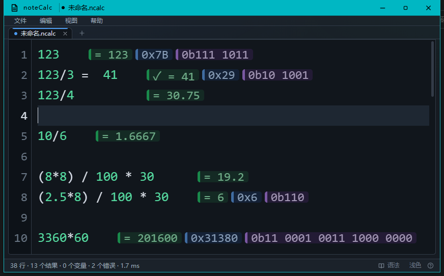

# noteCalc · Tauri

像写笔记一样进行计算，数据只保存在本机。

<p align="center">
  
</p>

noteCalc 是一个本地离线的计算笔记桌面应用：像写笔记一样逐行输入算式，结果以行尾虚拟徽标显示，
相邻表达式的结果自动按组对齐；行号、语法高亮与成对括号 / 引号匹配让公式更易读。
界面用 **React 19 + TypeScript**，计算引擎与文件读写都在 **Rust** 侧，由 **Tauri 2** 打包为桌面程序。

> **参考说明：** 原始交互思路参考在线工具 [NoteCalc](https://tsfullstack.heartstack.space/noteCalc)，
> 应用名沿用仓库名 `noteCalc`；本项目是独立开发的本地离线实现，与该在线工具的官方无关。

## 运行

从源码运行或构建需要 Node 22、pnpm 与 Rust 1.82+；Windows 还需要 WebView2 运行时
（Win11 自带，装了新版 Edge 的 Win10 也有）。只运行发布版时不需要 Node 和 Rust。
Linux / macOS 的系统依赖见 [Tauri prerequisites](https://tauri.app/start/prerequisites/)。

```bash
pnpm install
pnpm tauri dev                 # 开发模式（自动拉起 Vite，端口 1420，改代码即时生效）
pnpm dev --open                # 只调界面：浏览器打开 1420，不编译 Rust
pnpm tauri build               # 发布构建（可执行文件与安装包）
pnpm tauri build --no-bundle   # 只出可执行文件，跳过安装包封装
pnpm start                     # Windows：启动 release 版（缺产物或源码更新时自动构建）
```

Windows 下根目录还提供三个双击入口：

- `run.bat` — 启动 release 版；产物不存在或源码比产物新时会自动构建，想直接体验发布版用这个。
- `dev.bat` — 调试版窗口（真引擎、真标题栏）；改前端走热更新，只有改 Rust 才增量编译。
- `preview.bat` — 浏览器预览，在 http://localhost:1420 打开，不编译 Rust。

`run.bat` 支持 `-Rebuild`、`-Dev`、`-SkipBuild` 开关。`dev.bat` 与 `preview.bat` 都依赖
命令行窗口，关闭窗口即停止；两者共用 1420 端口，不要同时开。
浏览器里没有 Tauri 运行时，标题栏会显示“浏览器预览”，计算结果使用内置示例数据，
不能打开或保存文件，其余界面、徽标、对齐与交互都能预览。

## 功能

**计算**

- 四则运算、括号、乘方与百分比；支持 `0x2D0`、`0b1010` 十六进制 / 二进制字面量
- `[]`、`{}`、`()` 与 `""`、`''` 都能写数组，元素用逗号或空格分隔、允许一个结尾逗号，
  `{123, 567, 100}`、`{123, 567, 100,}`、`{123 567 100}` 等价；支持逐元素运算、百分比、
  函数与单位换算
- 数组结果沿用输入时使用的括号 / 引号与分隔符：`"100 1000 10" / 5` 得 `"20 200 2"`，
  `[100 1000 10] / 5` 得 `[20 200 2]`，`{100, 1000, 10} / 5` 得 `{20, 200, 2}`
- 数组表达式可跨行书写，结果显示在闭合括号所在行；续行期间遇到空行会取消本次表达式
- 中文 / 英文变量与顺序引用；行内多赋值（逗号、分号、全角分隔符）
- 数学函数与常量、长度 / 重量 / 面积 / 体积 / 温度 / 时间单位换算、等式正确性校验
- 标题、二级标题、注释行，以及普通文字的自动判定（不认识的文字不报错）
- 单个笔记最多 2000 行；默认小数位 4（0–12）

**编辑**

- 结果以行内虚拟徽标渲染，不写入笔记正文；相邻表达式的结果按组对齐，徽标与正文的最小间距
  可按字符数调整
- 行号、变量 / 数字 / 函数 / 单位 / 运算符差异化高亮，当前行高亮，成对括号与引号匹配
- 有效表达式后输入 `=` 显示灰色结果补全，`Tab` 或 `→` 接受，`Esc` 隐藏
- 单击结果徽标复制纯结果，`Ctrl+Shift+C` 复制光标所在行结果
- 选中文字后按 `(`、`[`、`{`、`'`、`"` 或 `` ` `` 会用配对的另一半包住选区（按右半边也一样），
  包裹后选区保持选中，一次撤销即可退回
- `Ctrl+F` 查找、`Ctrl+H` 替换与全部替换；“编辑”菜单提供撤销、重做、剪切、复制、粘贴、全选
- 类 Notepad++ 多文件标签：显示文件名与未保存状态，关闭有修改的标签会提示保存 / 丢弃 / 取消

**外观**

- 深色 / 浅色主题；字号可用 `Ctrl+鼠标滚轮` 缩放，制表符按 4 字符宽排版，`#` / `##` 标题为蓝色粗体
- 可调显示精度与结果间距；“编辑”菜单可分别启用整数结果的十六进制与二进制徽标（整数数组逐元素
  给出，沿用数组自身的括号或引号），二进制可按 4 位分组显示为 `0b1011 1111`；单击对应徽标即复制
  该进制值
- 自绘标题栏跟随窗口焦点与系统配色：强调色取自系统，Windows 开启“在标题栏和窗口边框上显示强调色”
  时整条填充，其余情况只描边；系统给不出颜色时退回内置配色，切到后台降调
- 标题栏、菜单栏与标签栏的高度取自系统，按 DPI 折算，各缩放比例下观感一致；读不到时用样式表
  自带的值

快捷键：`Ctrl+N` 新建、`Ctrl+O` 打开、`Ctrl+S` 保存、`Ctrl+Shift+S` 另存为、`Ctrl+F` 查找、
`Ctrl+H` 替换、`Ctrl+Shift+D` 切换主题、`F1` 语法帮助。

## 数据与文件

- 笔记默认保存为 `.ncalc`，也接受 `.txt`；读取按 UTF-8（容忍 BOM），写入 UTF-8、LF 换行
- 会话（标签、未保存内容、主题、字号、精度、徽标开关、结果间距、窗口几何）保存在系统的
  应用数据目录；Windows 下是 `%APPDATA%\com.localtools.notebookcalc\session.json`
- 打开 / 保存 / 另存为 / 导出都使用系统文件对话框，读写本地文件

## 代码结构

```text
src/                    前端（React）
  App.tsx               标签、菜单、会话、文档流程
  components/           TitleBar / MenuBar / TabBar / NoteEditor / FindReplaceBar / HelpPanel …
  lib/                  ipc（含浏览器预览降级）、badges（徽标与配色）、highlight（语法高亮）、
                        measure（等宽字宽与 Tab 停靠）、clipboard、demo、example
docs/screenshot.png     README 顶部截图
src-tauri/src/
  calc/                 Rust 计算引擎（units / value / parser / eval / document / selfcheck）
  session.rs            会话读写
  metrics.rs            窗口度量（Windows 读标题栏·SM_CYMENU·SM_CYSMSIZE 与菜单字体；macOS·Linux 用惯例值）
  theme.rs              系统标题栏配色（Windows 注册表 / macOS defaults / GNOME·KDE 设置）
  lib.rs                Tauri 命令：evaluate、calc_metadata、文件读写、导出、会话、窗口度量
```

计算引擎不依赖第三方库；前端只用 React，徽标、高亮与排版测量都是手写 CSS 与 Canvas。

## 实现说明

- 计算引擎在 Rust，前端不参与运算
- 数组字面量：引号与括号等价，空格也能分隔元素，各分隔符都允许一个结尾逗号；
  数组结果沿用输入时使用的括号 / 引号与分隔符；支持 `0b` 二进制字面量，以及整数数组的
  十六进制 / 二进制徽标
- 成对高亮同时覆盖括号与引号：光标贴着 `"` 或 `'` 时，高亮同一行里与其配对的另一个同类引号
- 选中文字后按括号或引号，会用配对的另一半包住选区（左半边、右半边都认，引号用同一个字符
  配对）；包裹后选区保持选中，一次撤销即可退回
- 文件对话框与磁盘读写都在 Rust 侧完成
- 浏览器预览是调试通道，用示例结果占位
- 显示设置（进制徽标、结果框强度、小数位、主题）改动后会立即写入会话，避免被强制结束
  进程时丢失
